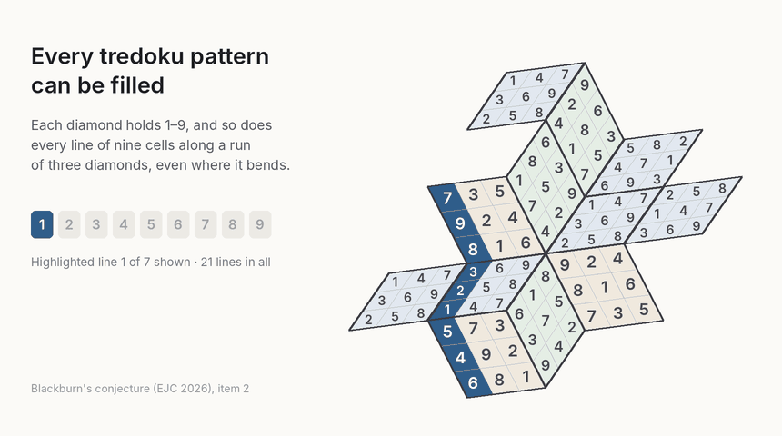

# Every tredoku pattern admits a digit filling

The Lean badge covers the logical core only: the crossing lemma and the labelling. The run structure of patterns is a hypothesis there.

**Answer: yes.** Every tredoku pattern can be filled with the digits 1–9 so that every diamond, and every line of nine cells along every run of three diamonds, contains each digit exactly once. This proves the conjecture in Blackburn's *Tredoku patterns* (Electron. J. Combin. 2026), concluding remarks, item 2.

[Paper (PDF)](paper/manuscript.pdf) ·
[TeX source](paper/manuscript.tex) ·
[Problem and proof](proof/PROBLEM_AND_PROOF.md) ·
[Mathematical audit](audits/public_safe_reports/MATHEMATICAL_AUDIT.md) ·
[Literature and priority audit](audits/public_safe_reports/LITERATURE_PRIORITY_AUDIT_2026-11-26.md) ·
[Scope and limitations](CLAIM_SCOPE_AND_LIMITATIONS.md) ·
[Reproduce](REPRODUCIBILITY.md) ·
[3D explorer](visualization/README.md) ·
[Citation](CITATION.cff)

## The problem

Tile the plane with equilateral triangles. A *pattern* is a finite set of non-overlapping diamonds, each made of two triangles that share an edge. A *run* is a maximal sequence of distinct diamonds, where consecutive diamonds share an edge and all of these shared edges are parallel. A *tredoku pattern* (Preece; Blackburn) is a pattern of at least three diamonds that satisfies four conditions:

- every run has length 1 or 3;
- the pattern is edge-connected;
- it is simply connected;
- it stays connected when any one diamond is removed.

These patterns are the grids of the Tredoku puzzle.

Blackburn ([EJC 33(3) (2026) #P3.58](https://doi.org/10.37236/13659), [arXiv:2407.10752](https://arxiv.org/abs/2407.10752)) divides each diamond into a 3×3 grid and asks a question. Can the sub-diamonds always be numbered 1–9 so that each diamond, and each line of nine sub-diamonds following a run of three, contains every number once? He conjectures that the answer is yes. The question was still open in the published version (September 2026).

## The result

**Theorem.** Every tredoku pattern admits such a filling. More generally, take any q ≥ 2 and any finite set of non-overlapping diamonds subdivided q×q. Then there is a labelling by (ℤ/q)² in which every diamond, and every line along every run of exactly q diamonds, contains each label once.

- **Lines keep their index across bends.** Give each of the three lattice directions one fixed orientation. Then a sub-diamond's position along a direction is the same on both sides of every shared edge, even where the line bends into a diamond of another orientation.
- **The labelling.** Attach the forms x, y and x+y (mod q) to the three directions, and give the diamonds of each run distinct offsets. Label each sub-diamond by the unique (x, y) whose two forms equal its two coordinates plus the offsets. Each diamond receives all q² labels. A line receives q disjoint fibres of one form, which together are all q² labels.
- **What is used.** Only that the diamonds do not overlap; none of the connectivity conditions are needed. The ingredients are standard: de Bruijn ribbons, Latin squares and design keys. The new part is the observation that they suffice.

## Explore the proof in 3D

The [interactive explorer](visualization/README.md) shows a genuine tredoku pattern with 12 diamonds and 7 runs of three, every one of which bends. It is drawn as the 3D stepped surface the pattern represents. Click a cell to light up its diamond and its lines. Switch the run offsets to zero to watch the construction fail.

Download [`visualization/tredoku-filling-explorer.zip`](visualization/tredoku-filling-explorer.zip), unzip it, and open the HTML file in a browser. It runs offline and uses no external libraries.

## Verification status

| Gate | Status |
|---|---|
| Proof | Complete and analytic; it does not rely on computation |
| Mathematical audit | Three independent AI audits (hostile, reconstruction, scope and computation): all pass, no invalid step found. One auditor found the same construction before reading the proof |
| Computation | Corroborating only: an exact geometric lattice simulation (124,101 lines) with a negative control; the auditors checked 330 genuine tredoku patterns (25,440 lines) |
| Literature and priority | Three search lanes through 2026-11-26. The result appears to be new after a documented search; the ingredients are standard and credited |
| Formal verification | Partial: the logical core is checked in Lean 4 ([`formalization/`](formalization/README.md)). The run structure of patterns is a hypothesis there |
| Peer review | Not peer reviewed |

## Citation

Version 1.0.1 is archived at Zenodo: version DOI [10.5281/zenodo.24544626](https://doi.org/10.5281/zenodo.24544626), concept DOI for all versions [10.5281/zenodo.24544625](https://doi.org/10.5281/zenodo.24544625). Version 1.0.1 is the reviewed Version 1.0.0 plus archive metadata only; the mathematics, manuscript, code and logs are unchanged. The immutable GitHub releases are [v1.0.0](https://github.com/DannyExperiments/tredoku-pattern-digit-filling/releases/tag/v1.0.0) and [v1.0.1](https://github.com/DannyExperiments/tredoku-pattern-digit-filling/releases/tag/v1.0.1). See [`CITATION.cff`](CITATION.cff).

## Authorship and AI disclosure

The repository author identity is `DannyExperiments`. AI systems found the proof, audited it, wrote the verification and Lean code, ran the literature review and prepared the manuscript; no AI system is listed as an author. See [`AI_DISCLOSURE.md`](AI_DISCLOSURE.md) and [`PROVENANCE.md`](PROVENANCE.md).
